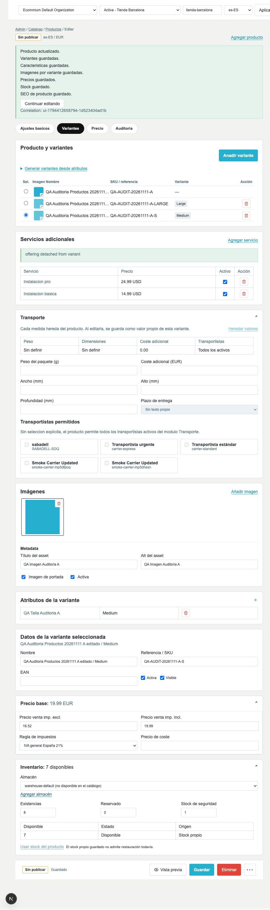
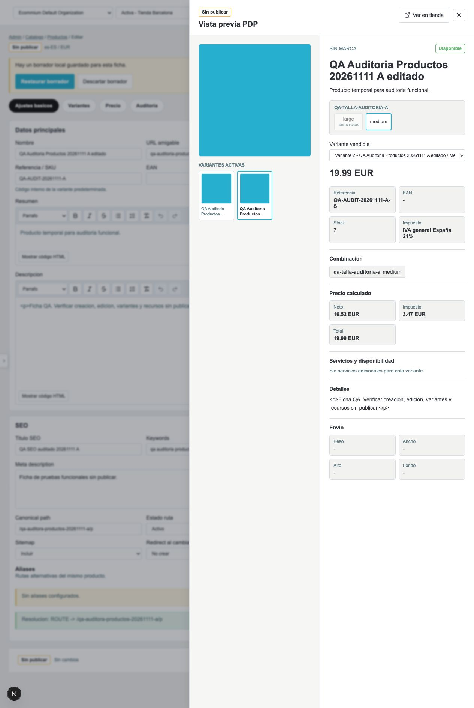
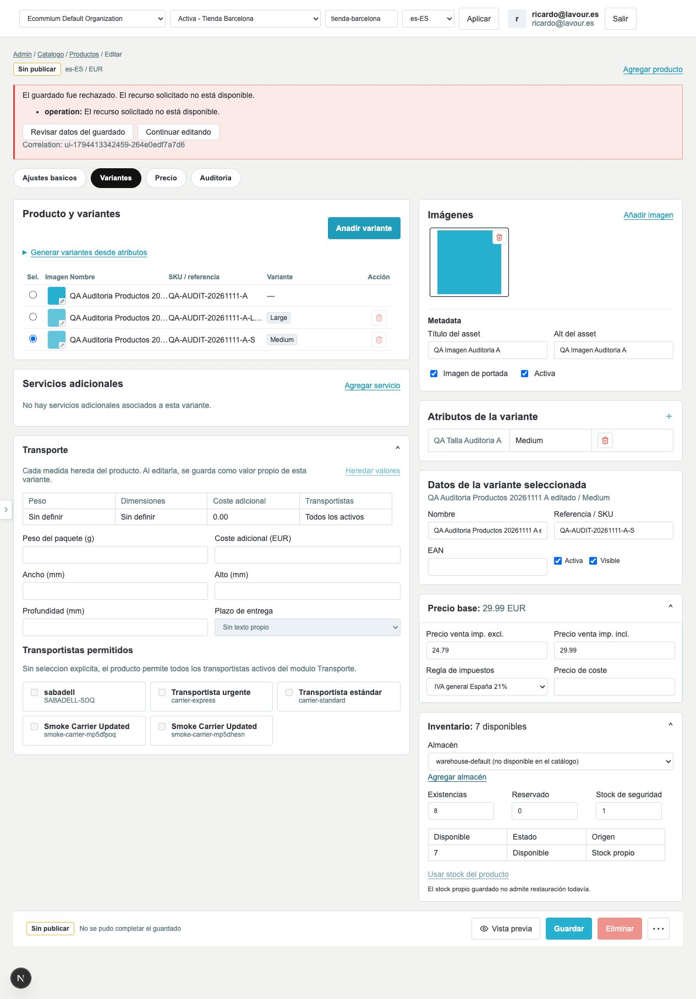
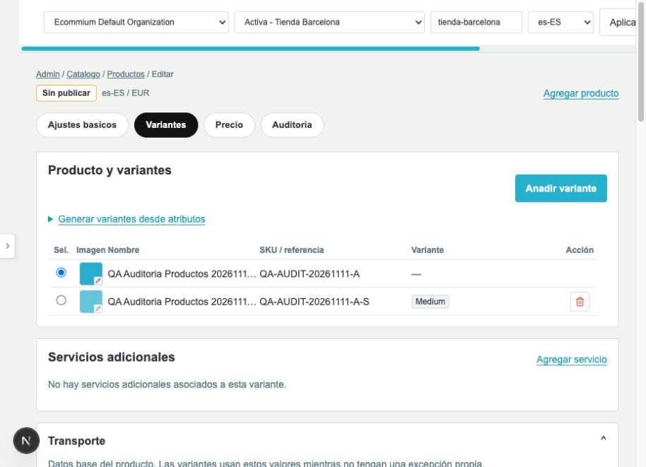
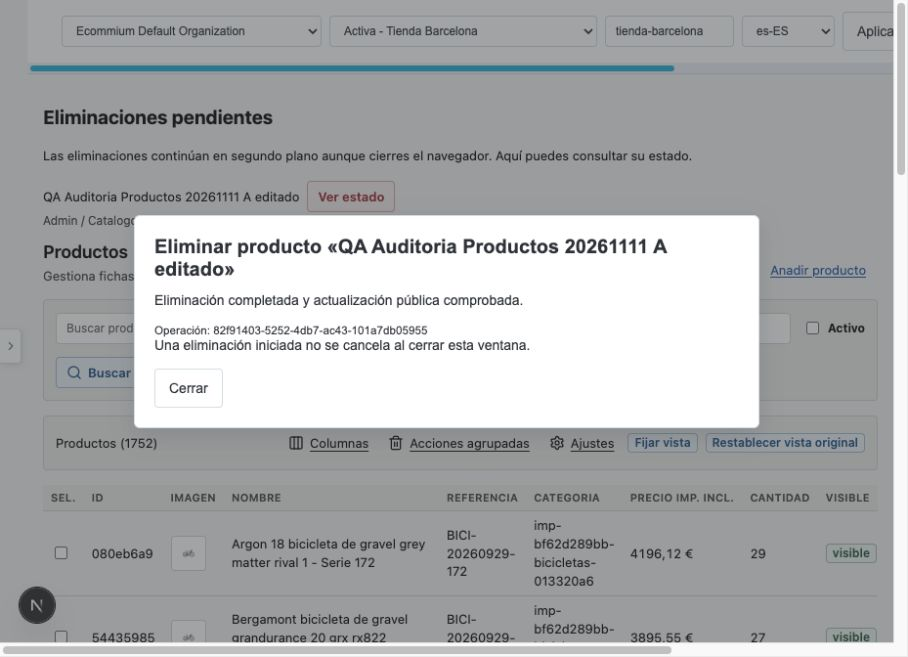
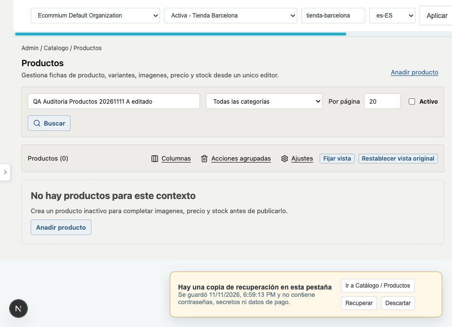
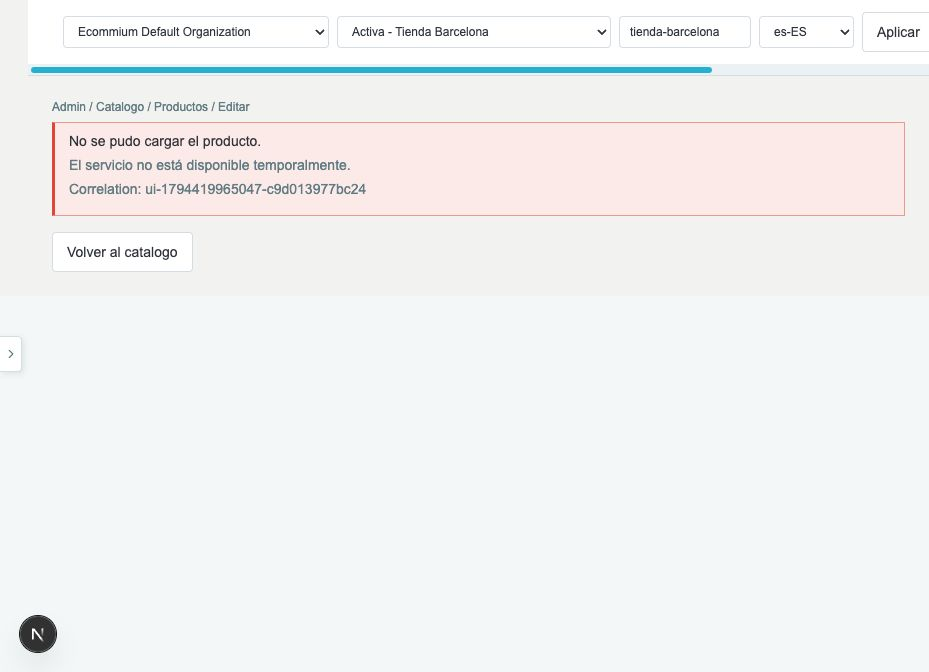

# Auditoría de Productos — 11 noviembre 2026

El módulo permite operar productos y variantes, pero no está listo para certificar todos sus flujos: existen fallos de sincronización visibles, un guardado rechazado y cobertura E2E pendiente de actualizar. No se han corregido comportamientos de negocio durante esta auditoría. Se han mantenido fixtures/selectores y añadido pruebas e informes reproducibles.

## Resultados y límites

| Batería | Resultado | Interpretación |
|---|---|---|
| Lint | Aprobado; 3 warnings previos | customerEmptyMutation, fallbackError y PdfInvoicePayload |
| Build Next.js | Aprobado | Verificación inicial del estado auditado |
| Unitarias iniciales | 643/648; 5 fallos | Tres imports del harness VM, una expectativa de UI retirada y un matcher de URL sin contexto |
| Unitarias tras mantener harness/fixtures | 648/648 | No implica cobertura total de negocio |
| Navegador inicial con BFF simulado | 34 aprobados, 35 fallidos, 1 omitido | 70 escenarios |
| Misma selección tras actualizar selectores | 50 aprobados, 19 fallidos, 1 omitido | Mezcla de deuda del test y candidatos funcionales; no son 19 defectos confirmados |
| Regresiones nuevas de servicios | 2 fallos reproducibles | Coinciden con pruebas reales; se conservan rojas |
| Caso nuevo transporte + SEO | 1 aprobado | Payload conjunto de dimensiones, coste, plazo, transportistas y aliases |
| Suites backend focalizadas | 87 aprobados | BFF 63, Catalog 10, Shipping 7, Inventory 7; no es el monorepo completo |
| TypeScript y ESLint focalizado de pruebas/herramientas | Aprobados | Tras añadir los nuevos escenarios |

Las pruebas reales utilizaron sesión Employee, Tienda Barcelona, es-ES/EUR y exclusivamente la UI/BFF. El usuario habilitó sesión y contexto. No se modificó el producto Argon original. La ejecución automatizada real con las credenciales configuradas fue rechazada en login; la evidencia real posterior procede del navegador autenticado por el usuario, no de ese runner.

No se ha certificado publicación pública, checkout, importación CSV real, rendimiento Lighthouse ni accesibilidad completa del módulo. Las pruebas existentes de axe/responsive son parciales. El laboratorio de retirada real permanece omitido porque requiere su entorno aislado. El usuario confirmó los dos borrados QA. Se ejecutaron la retirada de LARGE y después la del producto; el resultado y sus límites se detallan al final.

## Hallazgos confirmados

### P1 — Desactivar y retirar servicios deja una tabla falsa

En la variante QA se asociaron Instalacion pro e Instalacion basica: ambos aparecieron inmediatamente. Al desactivar pro, la respuesta confirmó `offering relation deactivated`, pero su checkbox siguió marcado. Al retirar cada servicio, apareció `offering detached from variant`, pero permanecieron sus filas. La revisión canónica de eliminación del producto contó **0 servicios asociados**; tras recargar desaparecieron.

Las acciones de desactivación y retirada en `src/modules/catalogo/product-actions.ts` vuelven a resolver el listado por `resolveOfferingsBatchByVariants`, susceptible a proyección atrasada. La asociación ya dispone de un snapshot canónico de mutación; las otras acciones no ofrecen la misma garantía visual.

Se añadieron dos tests con mutación exitosa y lectura intencionadamente atrasada. Ambos fallan sobre el estado actual, probando el checkbox y la ausencia de fila. Recomendación: devolver y aplicar estado canónico de relaciones en todas las mutaciones, distinguiendo activación del servicio y de la relación, y reconciliar después con la lectura.



### P1 — Marca asignada fuera de las primeras 100 no se representa

Se creó y asignó la marca QA. Al reabrir el producto, el selector mostraba «Selecciona» y el resumen «Sin marca». La marca existía en el listado buscable y el draft canónico conservaba su `brandId`. `getProductEditorLookups` en `src/modules/catalogo/products.ts` limita el lookup inicial a 100 marcas; la QA quedó fuera de ese lote.

Esto confirma un error de representación y selección asistida; no demuestra pérdida del identificador. Recomendación: resolver siempre la opción asignada por ID y añadir búsqueda paginada, evitando que una opción ausente se interprete como eliminación.

### P2 — La descripción en preview muestra etiquetas HTML

La vista previa del editor mostró literalmente `<p>Ficha QA…</p>` en Detalles. La descripción se renderiza como texto, aunque el editor almacena contenido enriquecido. Recomendación: usar el renderizador sanitizado compartido y probar HTML permitido y contenido peligroso; no insertar HTML sin sanitización.



## Incidencias observadas pendientes de aislar

| Incidencia | Evidencia y límite | Siguiente prueba |
|---|---|---|
| Precio propio de variante rechazado | Cambiar a 29.99 y guardar devuelve «El recurso solicitado no está disponible». Correlación `ui-1794413342459-264e0edf7a7d6`. El último guardado persistido sigue siendo el anterior | Seguir la petición y el recurso que genera 404; no atribuirlo a Pricing sin traza |
| Creación de servicio sin fila visible | QA Servicio Auditoria A, 5.50 EUR: el formulario vuelve al listado; búsqueda exacta, incluso Todos, devuelve 0 | Capturar respuesta canónica e ID antes de concluir que se creó o que se perdió |
| Lookup fiscal temporalmente no disponible | Avisos de impuestos/políticas y selector deshabilitado; impedía guardar el precio. Recarga y restauración del borrador permitieron continuar | Simular caída parcial y recuperación sin perder datos |
| Precio de preview 0 frente a 99 en fixture | Un escenario mantenido sigue fallando | Aislar selección/mapper. El preview real heredado de 19.99 sí funcionó; no generalizar |



## Matriz de comprobaciones

«Real» significa acción observada en la UI con servicios disponibles. No implica que cada operación CRUD de la fila esté aprobada.

| Recurso | Verificado | Pendiente o fallo |
|---|---|---|
| Listado | Fixtures de filtros, navegación y vistas | Verificación real completa de búsqueda, orden, paginación y bulk |
| Producto/borrador | Crear, editar nombre, guardar sin publicar, reabrir, recuperación local y auditoría de bloques | Publicación/desactivación real, duplicación y conflictos concurrentes |
| Variantes | Manual, generada con atributo registrado, selección, badge, edición de valor y actualización de nombre; persistencia | Eliminación de LARGE completada y ausencia comprobada antes de retirar el padre |
| Atributos/grupos | Crear grupo/campo ligado a categoría, opciones Small/Large y añadir Medium; asignar/cambiar y recargar | Editar/eliminar cada recurso global y dependencias |
| Categoría | Crear y asignar; persistencia | Editar, jerarquía y retirar categoría real |
| Marca | Crear/asignar, editar, desactivar mediante borrado lógico; ver inactiva con nombre editado | Lookup limitado confirmado; refresco de edición fue eventual |
| Características | Suites existentes y revisión del formulario | CRUD real completo y actualizar selectores antiguos |
| Media | Subir PNG sintético, portada, título/alt, guardar y reabrir | Orden, retirada independiente y recuperación de imagen rota requieren más pruebas |
| Servicios | Asociar dos a una variante; retirada canónica comprobada | Desactivación/retirada visual fallan; creación global sin confirmación visible |
| Precio/impuestos | Base 19.99 con IVA 21%, neto 16.52; herencia y preview persistentes | Precio propio rechazado; reglas avanzadas no certificadas en vivo |
| Inventario | Base 12; variante 8, reservado 2, seguridad 1 = 5; guardar/reabrir. Liberar reserva a 0 = 7 | Matriz multi almacén, errores, cambios de almacén y CRUD global completos no certificados |
| Transporte | Excepción de ancho 420 en variante, guardar/reabrir y heredar valores; caso fixture conjunto de coste/plazo/carriers/SEO | No se certificó cotización/fulfillment real |
| SEO/preview | Título SEO, slug/canonical y preview de variante; aliases en fixture | Publicación, sitemap/redirects públicos y buscador real |
| Auditoría/permisos | IDs, bloques de guardado, contexto; escenarios de permisos existentes | No auditoría integral de todos los perfiles |
| Eliminación | Revisión de impacto, bloqueo por stock reservado, cancelación, referencia incorrecta deshabilita acción | LARGE retirada, padre conservado durante esa comprobación; después producto eliminado y búsqueda vacía |

La revisión de eliminación detectó el stock reservado artificial y bloqueó la retirada. Tras liberarlo se permitió revisar: 20 unidades, 2 registros de stock, 0 reservas, 0 servicios y una imagen sin referencias ajenas. Inicialmente no se pulsó la confirmación final; se ejecutó después de recibir autorización específica del usuario.

## Deuda de pruebas y riesgos de código

Los 19 fallos restantes incluyen nombres/paneles retirados del generador y características, layout de precios, nombres de botones de media, una pestaña Imagenes ya inexistente, placeholders, conteo de paneles, menú de footer y expectativas de publicación. Deben migrarse al comportamiento vigente antes de atribuirlos a defectos. Dos escenarios de visibilidad/guardado y el preview de precio requieren aislamiento funcional.

La expectativa de vaciar localStorage tras guardar es obsoleta: el código conserva expresamente un snapshot reconocido para soportar lecturas proyectadas atrasadas. Su mera presencia no es un fallo. Los tests antiguos de media rota tampoco bastan para certificar un defecto: el filtro de previews puede ocultar además la acción de recuperación y merece un escenario nuevo.

En las acciones genéricas de taxonomía `updateEntityAction/deleteEntityAction` se observó falta de comprobación explícita de `BffResult.ok` antes de revalidar. Es un riesgo de feedback ante rechazo, no un fallo real forzado durante esta auditoría.

## Reproducción y artefactos

```sh
npm run lint
npm run build
npm test
npx tsc --noEmit
npm run audit:products
```

El runner es **solo fixtures** y guarda logs, JSON, informe y salidas de navegador bajo `artifacts/products-audit/<fecha>/`. La matriz de alcance está en `tests/audit/products-scope.json`. La selección amplia original contiene 70 casos; con las tres pruebas añadidas contendrá 73. No sumar ejecuciones repetidas como cobertura diferente.

Resultados de esta ejecución: `artifacts/products-audit/20261111/baseline/`, `maintained/`, `regressions.json` y `extended.json`. Son artefactos locales ignorados por Git; este documento y las capturas contienen la evidencia versionable. El runner no habilita laboratorios destructivos. Consultar `tests/audit/README.md` antes de usar el spec optativo real.

## Recursos QA y estado al cierre

Producto sin publicar `9e161e51-81d8-4e20-b7cb-483243d0641a`, SKU `QA-AUDIT-20261111-A`, nombre QA Auditoria Productos 20261111 A editado. Variantes: `117f26bf-4cfe-41b2-bd87-1757bc19122f` (SKU terminado en -S, atributo Medium) y `81b21b68-ba39-4f9f-9d47-2833665ae5c7` (-LARGE). Imagen sintética `643e9731-5086-476d-9952-fd481c5d6874`.

Categoría `4d652a3d-a103-41d5-a0e7-7904280d031f` sigue activa. Marca `4d84a3d8-d073-40f4-bd20-6cbccec80187` quedó inactiva tras borrado lógico. Grupo QA Grupo Auditoria 20261111 A y atributo QA Talla Auditoria A permanecen registrados. La creación de QA Servicio Auditoria A no tiene ID confirmado. Las definiciones de Instalacion pro y basica no se modificaron; solo sus relaciones con la variante QA.

Queda una edición local de precio 29.99 rechazada, no confirmada como persistida. La revisión caducada se renovó y se volvió a leer antes de ejecutar los borrados autorizados. No eliminar por coincidencias amplias de nombre ni afectar los datos QA anteriores de otras tareas.

Prioridad propuesta: corregir respuesta canónica de servicios y lookup de marca; aislar el rechazo de guardado de precio y creación de offering; corregir preview enriquecido; modernizar los 19 escenarios pendientes; después completar la matriz real, accesibilidad y rendimiento. No declarar el módulo aprobado hasta cerrar esos puntos.


## Ampliación: borrados QA confirmados y ejecutados

El usuario confirmó expresamente borrar LARGE y después el producto QA. Se realizaron nuevas revisiones de impacto antes de cada acción.

1. **Variante LARGE:** revisión con 0 unidades, 0 reservas, 0 servicios y 1 precio. Tras introducir su referencia exacta y ejecutar, la UI recargó el editor. La tabla mostró únicamente la variante base y Medium: LARGE había desaparecido y el padre seguía disponible.
2. **Producto:** revisión actualizada con 20 unidades sintéticas, 2 registros de stock, 0 reservas, 2 precios, 0 servicios, 1 ruta, 1 imagen y 1 colección; 0 referencias de otros productos y 0 importaciones pendientes. Se confirmó con su SKU exacto. La UI volvió al catálogo y la consulta de estado mostró **«Eliminación completada y actualización pública comprobada»**, operación `82f91403-5252-4db7-ac43-101a7db05955`.
3. **Confirmación frontend:** búsqueda exacta por nombre devuelve **Productos (0)**. La URL antigua ya no abre la ficha. La comprobación de retirada de imagen/datos propios procede del estado global completado del flujo; no se inspeccionó directamente el bucket ni la base de datos.

El producto y sus variantes ya no permanecen como dataset reutilizable. La categoría y grupo/atributo globales QA siguen registrados; la marca continúa inactiva. No se borraron estos recursos globales ni los QA de tareas anteriores.

**Hallazgo adicional de feedback:** la antigua URL muestra «No se pudo cargar el producto / El servicio no está disponible temporalmente» en vez de un estado claro de producto inexistente. Correlación `ui-1794419965047-c9d013977bc24`. Esto no invalida el borrado completado, pero confunde ausencia del recurso con indisponibilidad del servicio; requiere distinguir el error BFF antes de corregirlo. También apareció una copia local de recuperación en el catálogo después de retirar el producto; no se restauró ni se guardó sobre el recurso retirado.









Esta ampliación prueba el flujo real de eliminación de este conjunto aislado. No altera los resultados automatizados anteriores ni certifica todos los escenarios de dependencias, errores o retirada masiva. Solo se actualizó documentación/evidencia; no hubo cambios de código de aplicación ni se repitieron lint/build por este registro documental.


## Correcciones controladas 2026-11-12

Implementación autorizada por Ricardo después de la auditoría forense y del plan controlado. Esta sección sustituye las recomendaciones de corrección anteriores solamente para los comportamientos verificados aquí. No convierte los fallos antiguos ni los fixtures en pruebas reales adicionales.

### Resultado por caso

| Caso | Causa contrastada y cambio | Verificación actual |
|---|---|---|
| Servicios adicionales | La escritura iba a Pricing y la confirmación a una proyección atrasada. Además, `active` del servicio no representaba la relación. Pricing devuelve `relationActive` y conserva relaciones inactivas con `includeInactive`; BFF añade snapshot canónico primario tras activar/retirar. UI confirma ese snapshot, no una lectura proyectada. | API real devuelve relación desactivada con `active:true, relationActive:false` y lista vacía tras retirar. Playwright real comprueba checkbox y fila sin recargar; fixtures mantienen proyección atrasada. |
| Marca | Hay163 marcas totales/152 activas; iGPSPORT está fuera de las primeras100. El editor no resolvía la asignación que faltaba en el lote. | Resolución por ID, búsqueda/paginación BFF y preservación de selección. Producto QA abre con iGPSPORT seleccionado; fixture cubre151 opciones, página posterior y selección persistente. Una asignación no resoluble no se etiqueta como «Sin marca». |
| Vista previa | La cadena HTML enviada a Catalog se interpretaba por defecto como Markdown. Respuesta real inicial: `<p>&lt;p&gt;Ficha…`. | Guardado BFF declara `{format:"html",raw}` en create/update. Editor-state posterior devuelve `<p>Ficha <strong>QA controlada</strong></p>` y el navegador muestra negrita. Preview Storefront conserva el contenido rico y usa sanitización compartida. No se descodifican ni reescriben datos históricos por heurística. |
| Precio de variante | No se pudo establecer la causa del rechazo histórico. No se añadió una corrección especulativa de precios. | UI real guarda29,99EUR sobre variante QA con atributo registrado e IVA21%; editor-state confirma2999, `targetType:VARIANT`, variantId y pricingId propios. El rechazo histórico queda NO REPRODUCIDO en estas condiciones; no se afirma conocer su causa. |
| Creación de servicios | Alta persistida con201 y evento publicado; proyección tardó aproximadamente149s. Ya proyectado, buscar por nombre seguía devolviendo0: ReadIndex filtraba `name`, pero el snapshot contenía `localizedName`. | Filtro contempla los valores localizados. Mismo servicio pasa de0 resultados a1 por nombre. Creación desde formulario real devuelve referencia canónica y aviso explícito de proyección pendiente; después búsqueda por nombre recupera ese ID. No se repite POST para refrescar. |
| Impuestos | Lookup temporal no se reproduce con el proveedor sano; GET real devuelve200. Se verifica el fallo parcial mediante503 controlado. | Recarga explícita del recurso fiscal sin navegar ni perder borrador; mantiene snapshots tributarios existentes y validación de guardado. Selector de variante usa sus propias opciones. E2E comprueba caída/recuperación y nombre conservado. No hay impuestos inventados ni desactivación de validación. |
| Producto eliminado | ReadIndex trataba ausencia de fila en generación preparada como NOT_READY/503 y BFF traducía la ausencia como indisponibilidad. | ReadIndex devuelve404 solo si la generación está preparada; BFF lo conserva. UI real antigua devuelveHTTP404 y «Producto no encontrado». Generación no preparada continúa503. Sin nuevos borrados de productos. |

### Evidencias locales verificables

Directorio `artifacts/forensic-20261112/` (local, excluido de Git):

- `services-baseline.log`: dos E2E de servicios fallaban antes de corregir el contrato; el primer intento dentro del sandbox falló por EPERM y no se contó como reproducción. La repetición autorizada fuera del sandbox sí ejecutó los dos flujos.
- `relations-baseline-valid.json` y `relations-after.json`: respuestas reales de las relaciones QA antes/después. `services-ui-live.json`, `services-disabled-live.png` y `services-removed-live.png`: comprobación real de UI sin recargar. El intento con `.uncheck()` falló porque Playwright exige cambio inmediato; se repitió con click y espera de confirmación del servidor, sin cambiar la implementación por ese error del driver.
- `qa-resources.json`, `qa-editor-state.json`, `editor-after-save.json`: identidades QA, HTML escapado inicial y estado persistido posterior.
- `variant-save-live.json`, `variant-save-live.png`, `preview-formatted-live.png`: guardado real y representación después de reabrir. Correlación del guardado: `ui-1794477069727-19586fbb861c9`.
- `creation-read.json`, `service-name-search-before.json`, `service-name-search-after.json`, `service-ui-create.json`, `service-form-search.json`: creación, retraso, búsqueda y confirmación del formulario.
- `removed-after.json`, `removed-ui-after.json`:404 de BFF y navegador sobre producto previamente retirado.
- `e2e-final.log`, `e2e-final-confirmed.log`, `all-unit.log`, `controlled-unit.log`, `lint.log`, `build.log`: resultados ejecutados en esta entrega. Los logs del backend se copiaron al mismo directorio con prefijos `bff-`, `pricing-` y `readindex-`.

Lectura diagnóstica de Pricing confirmó `offerings.offering_id` QA persistido y `commerce_read_outbox.published_at=2026-11-12T09:36:56.496Z`, `attempts=1`, `last_error_code=null`. `.tmp/commerce-read-runtime/readindex.log` del composable registró aplicación de Pricing con `recordedToAppliedMs≈149359`; no se purgaron colas ni se redirigieron eventos. Supervisor y siete procesos hijos observados activos.

### Comandos y alcance de validación

- UI: `npm test` →652PASS; `npm run lint` →sin errores,3warnings en superficies ajenas; `npm run build` y `npx tsc --noEmit` PASS.
- Playwright: `npx playwright test tests/e2e/admin-login.spec.ts --grep 'controlled product brand|controlled tax lookup|controlled removed product|products audit service (deactivation|removal)|added offering appears immediately|offerings list shares' --reporter=line` →7PASS. Incluye axe sin infracciones en los selectores modificados y anchos1440/768/390. Son fixtures BFF controlados, separados de las pruebas reales anteriores.
- BFF: `npm test -- --runInBand admin-pricing.controller.spec.ts admin-product-save-operation.use-case.spec.ts http-admin-product-listing-read-index.reader.spec.ts` →59PASS; build/typecheck PASS.
- Pricing: `npm test -- --runInBand offering` →19PASS; build PASS.
- ReadIndex: `npm test -- --runInBand prisma-admin-product-absence prisma-admin-pricing-read` →6PASS; build PASS.
- Activación local selectiva: `PATH=<Node22/bin>:$PATH ./scripts/postman-services.sh restart-selected pricing commerce-read-index bff-admin`; después solo `commerce-read-index` para el filtro localizado. El primer intento con Node23 fue rechazado por el script antes de detener procesos. No se modificó configuración, no hubo migraciones y Storefront BFF no se reinició.

### Límites y estado del laboratorio

La medición de navegador sobre producción Next con BFF de fixtures dio TTFB31,3ms y399241bytes de JavaScript codificado cargado al abrir el editor. Supera el presupuesto general de250KB: esta entrega no certifica ese gate ni atribuye una regresión sin comparativa anterior. No se ejecutaron Lighthouse ni mediciones de campo p75/LCP/INP/CLS. No se amplía el trabajo a una optimización general del editor.

Producto QA `07adb336-a001-4f4e-bb0e-c6a20e8de0cd`, referencia `QA-CONTROLLED-1794476215692`, queda sin publicar y oculto, con variante adicional `d86db784-0b5e-4f78-b4a2-eb37b9400f36`, precio `56b388d7-8f6e-4dc3-b013-8f4409f235f4` e IVA21%. No tiene stock creado por esta entrega. Las relaciones de servicios probadas se retiraron. Servicios QA `be77fa02-d844-4782-8791-86c4b8e61bed` y `3a71eee6-dc79-4ed6-9895-4822cc2732f3` se dejaron inactivos mediante BFF; no se eliminaron datos reales ni recursos globales existentes. No se publicaron cambios ni se crearon commits.

Se mantienen los pendientes de securityReadme.md, incluido el alcance residual de SEC-003; declarar HTML y sanitizar su preview no certifica todo el saneado de backend. El laboratorio local no acredita despliegue productivo.

Cierre operativo: se cerró por UI la sesión QA creada para esta entrega y se retiraron los archivos temporales privados de credenciales y cookies. La búsqueda asistida descarta respuestas anteriores cuando hay consultas fuera de orden. `git diff --check` pasa en los componentes backend modificados; en el archivo UI grande detecta espacios de cambios previos fuera de los bloques de esta entrega, conservados sin limpieza ajena.

2026-11-12 — Rectificación de alcance solicitada por Ricardo: se retira el buscador añadido indebidamente al selector de categorías compartido. Categorías conserva desplegable y alta; la búsqueda/paginación queda exclusivamente en marcas. `npm run lint` sin errores (3 warnings existentes), `npm run build` PASS y Playwright `controlled product brand` PASS, con comprobación explícita de ausencia de búsqueda en categorías. Logs locales: `/private/tmp/ecommium-category-search-removal-{lint,build,e2e}.log`.

2026-11-12 — Segunda rectificación de alcance: se retira también el buscador de marcas. Ambos campos de búsqueda y sus botones desaparecen; permanecen los desplegables originales y la resolución de marca asignada por ID. Lint sin errores, build y E2E `controlled product brand` PASS; la prueba exige ausencia de ambos campos y mantiene axe/responsive. Logs: `/private/tmp/ecommium-search-fields-removal-{lint,build,e2e}.log`.

2026-11-12 — Ajuste de inventario solicitado por Ricardo: Almacén se alinea junto a Existencias/Reservado/Stock de seguridad; se retiran alta de almacén desde el editor, tabla local de disponibilidad y aviso de restauración de stock propio. Se conserva el flujo de selección/lectura/guardado y los errores operativos. Lint sin errores (3 warnings existentes), build y 3 unitarias de inventario PASS. Playwright `integrated inventory edits variants` PASS: cuatro controles alineados, ausencia de alta/tabla/aviso, guardado sin copiar cantidades, axe y responsive1440/768/390. Logs locales `/private/tmp/ecommium-inventory-layout-{lint,build,unit,e2e}.log`; capturas en test-results del escenario. Sin cambios BFF ni datos reales.

2026-11-12 — A petición de Ricardo, el bloque compacto Precio base incluye Precio tachado en producto y variante seleccionada. Usa listPriceMinor y los handlers de precio existentes; sin cambios BFF. Lint sin errores (3 warnings existentes), build y E2E de editor PASS:129,90 en producto,179,90 en variante, valores separados al cambiar selección y17990 en payload. Mantiene los controles axe/responsive del escenario. Logs `/private/tmp/ecommium-list-price-field-{lint,build,e2e}.log`.

2026-11-12 — Títulos solicitados por Ricardo: Precio sin IVA, Precio con IVA, Impuestos y Coste; cabecera Precio base con decimal localizado y símbolo monetario (ej.3814,65€). Campos numéricos del bloque compacto y precio base limitados a120px, sin cambiar cálculos ni payloads. Lint sin errores (3 warnings existentes), build,49 unitarias y2 E2E PASS; verificación de anchura y formato, guardado, recuperación fiscal y responsive. Logs `/private/tmp/ecommium-price-labels-{lint,build,unit,e2e}.log`.

2026-11-12 — Distribución solicitada por Ricardo: Precio sin IVA, Precio con IVA, Coste y Precio tachado comparten una fila; Impuestos queda aparte debajo. Aplicado a bloques compactos y pestaña Precio, conservando el orden de teclado y anchos máximos120px. En móvil la fila de importes permite desplazamiento horizontal. Lint sin errores (3 warnings existentes), build y2 E2E PASS con alineación de los cuatro controles, impuestos debajo, guardado y responsive. Logs `/private/tmp/ecommium-price-row-{lint,build,e2e}.log`.

2026-11-12 — A petición de Ricardo, Impuestos incluidos se añade a Ajustes básicos y Variantes junto a Impuestos, con columnas iguales50/50. Cada checkbox modifica taxIncluded del precio correspondiente mediante los handlers existentes. No se retira aún el bloque de la pestaña Precio. Lint sin errores (3 warnings existentes), build,44 unitarias y E2E PASS: proporciones en1440/768/390, estado independiente producto=false/variante=true y payload confirmado. Axe ampliado a la fila fiscal. Logs `/private/tmp/ecommium-tax-toggle-{lint,build,unit,e2e,a11y}.log`.

2026-11-12 — Retirada explícita del recuadro duplicado de Precio solicitada por Ricardo: se eliminan resumen gris de contexto, edición de importes/impuesto y checkbox de esa pestaña. Continúan en Ajustes básicos y Variantes; se conservan condiciones avanzadas, precios específicos, simulador y avisos operativos. Texto introductorio ajustado al contenido restante. Lint sin errores (3 warnings existentes), build,49 unitarias y2 E2E PASS: bloque ausente, datos conservados al volver a Ajustes básicos, guardado y simulación BFF operativos. Logs `/private/tmp/ecommium-price-block-removal-{lint,build,unit,e2e}.log`.

2026-11-12 — Icono de herencia solicitado por Ricardo: control RotateCcw de28px en el encabezado del precio de la variante adicional, sin nueva fila. Tooltip/nombre accesible identifica el origen real (producto o variante0). Reutiliza removeVariantPrice y la retirada se envía al Guardar; no modifica precio base ni añade endpoints. Deshabilitado si ya hereda o se está guardando; no aparece en la variante0. Lint sin errores (3 warnings existentes), build,44 unitarias y2 E2E PASS; precio persistido propio99→heredado1299, retirada de pricing-edit-green en payload, precio principal intacto, accesibilidad del icono habilitado y responsive del editor. El fixture de esta prueba usa precios BASE sin priceTableId, diferenciados de reglas de tabla. Logs `/private/tmp/ecommium-price-inherit-icon-{lint,build,unit,e2e}.log`.

2026-11-12 — Selector Tabla de precios añadido antes de Impuestos en Ajustes básicos y Variantes, por solicitud de Ricardo. Usa priceTableId y listas BFF existentes; cada selección edita su precio correspondiente. En una variante que hereda, el selector conserva el comportamiento previo de quedar deshabilitado hasta disponer de precio propio. Ancho de media fila; no cambia la fila fiscal50/50 ni se elimina aún el bloque de override. Lint sin errores (3 warnings existentes), build,44 unitarias y2 E2E PASS: tabla Cockpit VIP en producto/VIP table en variante, selecciones independientes y payload confirmado, posición anterior a Impuestos en1440/768/390 y herencia sin alterar el principal. Logs `/private/tmp/ecommium-price-table-field-{lint,build,unit,e2e}.log`.

### 2026-11-12 — Selectores de precio e impuestos

Tabla de precios e Impuestos comparten fila en Ajustes básicos y Variantes. Impuestos incluidos queda debajo de Impuestos. Sin cambios de guardado. Lint: 0 errores y 3 advertencias existentes. Build correcto. Playwright: 2 pruebas superadas (integrated inventory edits variants y variant price reload icon), con comprobación responsive y de herencia. Logs: /private/tmp/ecommium-price-selects-row-{lint,build,e2e}.log.

### 2026-11-12 — Retirada del override duplicado en Precio

Eliminado «Override de variante adicional», su tabla y los avisos asociados al bloque. Se conservan los precios específicos, el contexto avanzado y el simulador. La gestión del precio propio y la restauración de herencia permanecen en Variantes. Sin cambios de contratos o persistencia. Validación: lint (0 errores, 3 advertencias existentes), build correcto, 49 pruebas unitarias superadas y 2 E2E superadas (integrated inventory edits variants; variant price reload icon). Logs: `/private/tmp/ecommium-remove-override-lint.log`, `/private/tmp/ecommium-remove-override-build.log`, `/private/tmp/ecommium-remove-override-unit.log`, `/private/tmp/ecommium-remove-override-e2e.log`.

### 2026-11-12 — Retirada de la franja resumen de Precio

Eliminada únicamente la franja con Precio producto, Precio tachado, Neto preview, Impuesto preview y Bruto preview, junto con su cálculo local sin consumidores. Contratos y guardado conservados. Build correcto y 2 E2E superadas (integrated inventory edits variants; variant price reload icon). Logs: `/private/tmp/ecommium-remove-price-summary-build.log`, `/private/tmp/ecommium-remove-price-summary-lint-final.log`, `/private/tmp/ecommium-remove-price-summary-e2e.log`.
